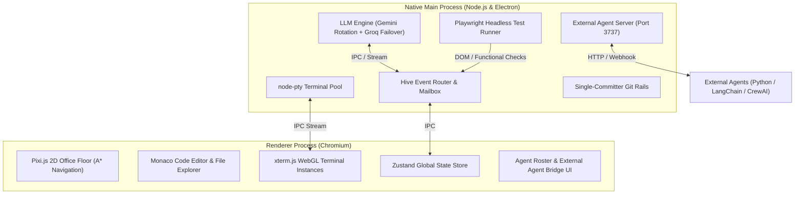
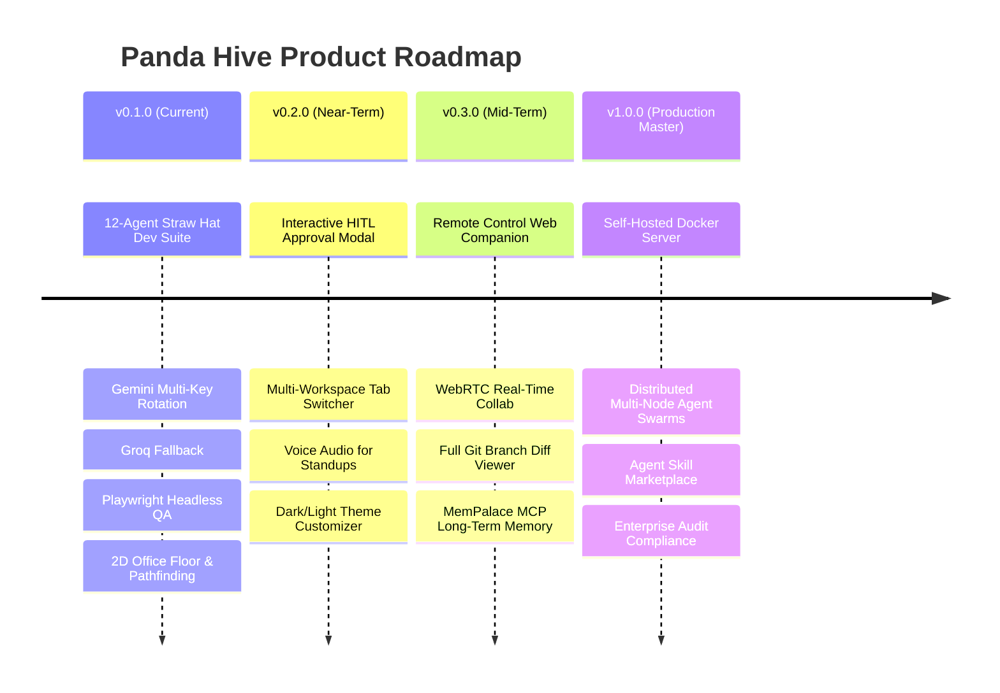

# 🐼 Panda Hive — Product Requirements Document (PRD)

| **Document Metadata** | **Specification** |
| :--- | :--- |
| **Product Name** | **Panda Hive** 🐼 |
| **Document Version** | `1.0.0` (Production Master) |
| **Product Version** | `0.1.0` (Active Release) |
| **Author / Lead** | Ayush Singh (`ayush.v.singh2611@gmail.com`) |
| **Architectural Role** | Antigravity (External System Engineering) |
| **Repository** | `https://github.com/ayushvsingh2611-code/office.git` |
| **Target Platforms** | Windows 10/11 (ConPTY/Win32), macOS (arm64/x64), Linux (X11/Wayland) |
| **License** | MIT License (Open-Source, Local-First, Privacy-Centric) |

---

## 1. Executive Summary & Vision

### 1.1 Product Vision
**Panda Hive** is an open-source, local-first multi-agent development harness and 2D virtual office simulation. It bridges modern AI coding CLIs (Claude Code, Gemini/Antigravity, OpenAI Codex, xAI Grok, Ollama) and external agent frameworks (LangChain, AutoGen, CrewAI, Lyzr) into a unified, visually observable, and self-coordinating autonomous engineering crew.

Instead of managing cluttered terminal windows or trusting black-box synthetic outputs, Panda Hive models an entire software engineering organization inside a living retro pixel-art office floor. Real PTY processes, file modifications, inter-agent messages, and test interactions are mapped to physical 2D workstations, speech bubbles, and interactive tools.

### 1.2 Core Value Proposition
- **Visual Observability**: Watch agents physically walk to workstations (Desks, Code Shelves, Terminals, Web Search, Whiteboards, Meeting Tables) as tasks execute.
- **Genuine Autonomous Execution**: No fabricated agent responses or mocked successes. Agents genuinely read predecessors' artifacts, write source code, execute terminal commands, and undergo real headless browser verification.
- **Provider Resilience**: Intelligent multi-provider orchestration featuring automatic Gemini API key rotation, Groq high-speed fallback (`openai/gpt-oss-120b`), and local LLM support.
- **Strict Quality Gates**: Integrated headless browser functional testing via Playwright (Chromium) that catches DOM regressions, modal overlay traps, and JavaScript runtime exceptions.
- **Local-First & Private**: Code, chat logs, terminal streams, and memory graphs reside entirely on the user's local disk with zero external tracking of proprietary code.

---

## 2. Problem Statement & Market Opportunity

### 2.1 The Terminal Sprawl Dilemma
Modern AI coding tools run in isolated CLI processes. Coordinating more than two agents leads to:
1. **Context Loss**: Agents cannot easily inspect or build upon artifacts produced by other agents.
2. **Silent Failure & Hallucination**: Without rigorous quality gates, agents mark tasks "complete" even when runtime syntax errors or CSS pointer-blocking bugs exist.
3. **Runaway Credit Burn**: Unsupervised agents stuck in recursive loops drain API tokens rapidly.

### 2.2 The Solution: Panda Hive
Panda Hive solves this by providing:
- A shared file-based stigmergy layer (`hive/` and `workspace/`).
- An authoritative 12-agent division of labor with distinct roles and deliverables.
- Real-time visual tracking with interactive pause/resume and 1-click **Sleep Mode** to eliminate token bleed.
- Real Playwright browser testing with honest QA rejection gates.

---

## 3. Product Principles & Tenets

1. **Local-First by Default**: The filesystem is the single source of truth. Git is used as the coordination and audit layer.
2. **Measured, Not Claimed**: Success is determined exclusively through verified compilation, clean V8 parsing, static DOM inspection, and automated browser interaction.
3. **Separation of Concerns**: UI design, backend logic, DevOps containerization, security review, and QA testing are executed by specialized agents with non-overlapping boundaries.
4. **Human-in-the-Loop (HITL) Friction Reduction**: The Lead Orchestrator ("God" / Luffy) manages routine subtasks autonomously, surfacing only destructive commands, budget spikes, or scope changes for human confirmation.
5. **Aesthetic Delight**: The "Panda Cyber-Bamboo" theme combines retro gaming nostalgia (*Press Start 2P*, Pixi.js sprites) with modern developer ergonomics (Monaco Editor, xterm.js WebGL, JetBrains Mono).

---

## 4. User Personas & Target Audiences

| Persona | Description | Primary Needs |
| :--- | :--- | :--- |
| **The Solo Founder / Indie Hacker** | Builds complete full-stack MVPs rapidly without hiring an engineering team. | End-to-end sprint automation, automated QA, multi-domain generation, budget failover. |
| **The Senior Staff Engineer** | Directs architecture while delegating boilerplate implementation and refactoring. | Code review enforcement (Zoro), containerization (Sanji), architectural contracts (Shanks). |
| **The AI Agent Researcher** | Develops custom multi-agent loops in Python/Go/LangChain/CrewAI. | Zero-overhead local REST/Webhook bridge (`http://127.0.0.1:3737`) to visualize custom agents. |
| **The Engineering Manager** | Monitors team velocity and cross-functional deliverables. | Visual office floor, sprint planning roadmaps, audit logs, and delivery telemetry. |

---

## 5. System Architecture

Panda Hive is engineered as an Electron application with strict process isolation between the native Node.js runtime and the WebGL-accelerated React renderer.



### 5.1 Key Subsystems
1. **Terminal Plane (`src/main/agentTools.ts`, `node-pty`)**: Spawns isolated PTY sessions for local CLIs with full ANSI color, Windows ConPTY compatibility, and WebGL terminal rendering.
2. **Hive Coordination Plane (`HIVE.md`, `src/main/externalAgentServer.ts`)**:
   - Manages asynchronous mailboxes (`inbox/` and `outbox/`).
   - Maintains an append-only event ledger (`log.jsonl`) and shared whiteboard (`board.md`).
   - Enforces single-writer file integrity.
3. **External Agent REST Server (`http://127.0.0.1:3737`)**:
   - Allows any external script or agent to emit events (`/api/agent/:id/event`), display thoughts (`/api/agent/:id/thought`), and receive prompts via Webhooks.
4. **Browser Functional Test Runner (`src/main/browserTestRunner.ts`)**:
   - Uses Playwright to load generated web applications in headless Chromium.
   - Evaluates modal states, click handlers, form submissions, and LocalStorage persistence.

---

## 6. The 12-Agent Autonomous Dev Suite (Straw Hat Crew)

Panda Hive features a specialized 12-agent development hierarchy that executes sequential sprints through 7 distinct milestones:

```
[User Prompt] 
      │
      ▼
Milestone 1: Luffy (Lead Orchestrator) ──► sprint-plan.md, project-plan.md
      │
      ▼
Milestone 2: Hancock (Requirements & BA) ──► spec.md
      │
      ▼
Milestone 3: Shanks (System Arch) & Nami (Data Arch) ──► architecture.md, data-models.md
      │
      ▼
Milestone 4: Franky (UI) & Usopp (Backend) ──► index.html, style.css, app.js
      │
      ▼
Milestone 5: Brook (Integrations) & Jinbe (Security) ──► integrations.md, security-review.md
      │
      ▼
Milestone 6: Chopper (QA) & Sanji (DevOps) ──► test-report.md, Dockerfile
      │   (Playwright Feedback Loops: Max 2 Retries to Franky/Usopp)
      ▼
Milestone 7: Zoro (Code Review), Robin (Docs), Luffy (Sign-Off) ──► code-review.md, README.md, sprint-signoff.md
```

### 6.1 Agent Roster & Responsibility Matrix

| # | Agent Name | Character ID | Primary Role | Core Deliverables | Default Station & Tool |
| :-: | :--- | :--- | :--- | :--- | :--- |
| **1** | **Luffy** | `sh-luffy` | Captain & Lead Orchestrator | `sprint-plan.md`, `sprint-signoff.md` | Board (`Read`) |
| **2** | **Hancock** | `sh-hancock` | Requirements & Business Analyst | `spec.md` (User stories & criteria) | Shelf (`Read`) |
| **3** | **Shanks** | `sh-shanks` | System Architect | `architecture.md` (System topology) | Terminal (`Read`) |
| **4** | **Nami** | `sh-nami` | Data Architect | `data-models.md` (Schemas & APIs) | Board (`Write`) |
| **5** | **Franky** | `sh-franky` | UI/UX & CSS Engineer | `index.html`, `style.css`, `ui-design.md` | Desk (`Edit`) |
| **6** | **Usopp** | `sh-usopp` | Backend & Logic Engineer | `app.js`, `engine-notes.md` | Terminal (`Write`) |
| **7** | **Brook** | `sh-brook` | Integrations & Content Specialist| `integrations.md`, mock payloads | Shelf (`Read`) |
| **8** | **Jinbe** | `sh-jinbe` | Security & Compliance Reviewer | `security-review.md` (Sanitization) | Terminal (`Read`) |
| **9** | **Chopper**| `sh-chopper` | QA Doctor & Test Runner | `test-report.md` (Playwright logs) | Terminal (`TodoWrite`) |
| **10**| **Sanji** | `sh-sanji` | DevOps & Infrastructure Engineer | `Dockerfile`, `deployment-guide.md` | Shelf (`Bash`) |
| **11**| **Zoro** | `sh-zoro` | Senior Code Reviewer | `code-review.md` (Quality gate sign-off) | Board (`TodoWrite`) |
| **12**| **Robin** | `sh-robin` | Technical Documentation Lead | `README.md`, `user-guide.md` | Shelf (`Read`) |

---

## 7. Functional Requirements (FR)

### FR-1: 2D Pixel-Art Office Floor & Avatars
- **FR-1.1**: Render a 2D tile-based isometric office environment using Pixi.js (v8).
- **FR-1.2**: Implement A* grid pathfinding so avatars walk realistically between workstations.
- **FR-1.3**: Display dynamic thought bubbles (`speechBubble`) above avatars showing current tools, thoughts, and progress percentages.
- **FR-1.4**: Provide dedicated functional zones:
  - *Desk*: Core code writing and editing.
  - *Shelf*: File reading, codebase indexing, and literature research.
  - *Terminal*: Shell execution, CLI builds, and testing.
  - *Whiteboard*: Architecture diagrams and milestone roadmaps.
  - *Warroom Table*: Multi-agent standups and team deliberations.

### FR-2: Multi-Agent Milestone Execution Pipeline
- **FR-2.1**: Break incoming user prompts into 7 sequential sprint milestones.
- **FR-2.2**: Pass predecessor deliverables as contextual inputs to subsequent milestones (e.g., Franky and Usopp consume `architecture.md` and `data-models.md`).
- **FR-2.3**: Prevent LLM response truncation with boundary self-healing (automatic recovery of cut-off JavaScript closures).
- **FR-2.4**: Generate a comprehensive execution audit log (`execution-audit.json`) recording every API call, token count, duration, and tool invocation.

### FR-3: AI Provider Engine with Failover & Key Rotation
- **FR-3.1**: Primary provider: Google Gemini (`gemini-3.5-flash-lite`).
- **FR-3.2**: Multi-key rotation: Maintain an active pool of API keys. Automatically cycle to the next key when HTTP 429 (Rate Limit) or HTTP 503 (High Demand) is received.
- **FR-3.3**: Secondary failover provider: Groq (`openai/gpt-oss-120b`). Automatically switch when Gemini exhausts retry limits.
- **FR-3.4**: Support Bring-Your-Own-Key (BYOK) for Anthropic Claude, OpenAI, and local Ollama endpoints.

### FR-4: Real Headless Browser QA Engine (Chopper)
- **FR-4.1**: Launch generated web applications in headless Chromium via Playwright.
- **FR-4.2**: Verify V8 syntax cleanly parses `app.js` with zero runtime compile errors.
- **FR-4.3**: Inspect semantic DOM elements (buttons, inputs, forms, modal dialogs).
- **FR-4.4**: Execute real browser clicks, form submissions, modal open/close cycles, and LocalStorage reloads.
- **FR-4.5**: Enforce honest gate outcomes:
  - If any interaction fails or an unhandled browser exception occurs, mark `browserFunctionalTesting: FAIL` and `finalQaApproval: REJECTED`.
  - Never fabricate a PASS verdict.
- **FR-4.6**: Dynamic feedback routing:
  - Route CSS, z-index, and pointer-event issues to **Franky**.
  - Route JavaScript exceptions and click-handler issues to **Usopp**.
  - Enforce a maximum of 2 automated revision attempts before locking final status.

### FR-5: 1-Click Agent Sleep Mode & Resource Saver
- **FR-5.1**: Provide manual `🌙 SLEEP` and `☀️ WAKE` toggle buttons on every agent card.
- **FR-5.2**: When asleep, suspend background PTY polling and prevent runaway API invocations.
- **FR-5.3**: Visual feedback: Avatar eyes close, lavender tint applied, `zzz 😴` thought bubble displays, and floating sleep particles render.
- **FR-5.4**: Auto-Sleep: Automatically transition agents to sleep state upon task completion to preserve API quota.

### FR-6: Embedded Monaco IDE & Git Rails
- **FR-6.1**: Integrated Monaco Editor (VS Code core) with syntax highlighting for HTML, CSS, JavaScript, TypeScript, Python, Markdown, and JSON.
- **FR-6.2**: Multi-tab workspace file tree with instant file switching.
- **FR-6.3**: Git Rails: Visualize branch commit graphs, inspect diffs, and perform guarded commits. Only the Electron main process commits to `.git` to prevent index locks.

### FR-7: External Agent REST Bridge (`127.0.0.1:3737`)
- **FR-7.1**: `POST /api/agent/:id/event`: Update agent status (`working`, `thinking`, `blocked`, `idle`, `sleeping`), current tool, station, and progress.
- **FR-7.2**: `POST /api/agent/:id/thought`: Render a speech or thought bubble over the agent avatar.
- **FR-7.3**: `POST /api/agent/:id/message`: Stream agent output directly to the sidebar chat feed.
- **FR-7.4**: Support outbound Webhooks to push user prompts directly to external agent endpoints (e.g., Python FastAPI at `http://localhost:8000/chat`).

---

## 8. Non-Functional Requirements (NFR)

### 8.1 Performance & Responsiveness
- **Floor Frame Rate**: Pixi.js canvas must maintain a stable 60 FPS on standard integrated GPUs.
- **IPC Latency**: Terminal stream chunks between native PTY and renderer xterm.js must transfer in under 15ms.
- **Memory Footprint**: Base harness idle memory usage must remain under 350 MB RAM.

### 8.2 Reliability & Fault Tolerance
- **Zero Silent Failures**: All API errors, network timeouts, and model rate limits must be surfaced in the UI and logged.
- **Process Recovery**: If an agent PTY terminates unexpectedly, the harness must auto-recover the session without crashing the Electron window.
- **No Cascade Deadlocks**: An issue in one agent's execution must not block or crash unrelated agents.

### 8.3 Security & Data Privacy
- **Local Isolation**: The external REST server binds exclusively to loopback interface `127.0.0.1`. Remote network access is blocked by default.
- **Zero Telemetry of Code**: User code, generated artifacts, and API payloads are never transmitted to third-party tracking servers.
- **Secret Masking**: API keys entered into `.env` or the UI are masked and stored securely in local app configuration.

### 8.4 Cross-Platform Compatibility
- Supported Operating Systems:
  - Windows 10/11 (x64) via ConPTY
  - macOS Monterey+ (Apple Silicon M1-M4 & Intel x86_64)
  - Ubuntu 20.04+, Debian 11+, Fedora 36+ (x64)

---

## 9. Data Schema & File Specifications

### 9.1 Execution Audit Schema (`execution-audit.json`)
```json
{
  "$schema": "http://json-schema.org/draft-07/schema#",
  "title": "PandaHiveExecutionAudit",
  "type": "object",
  "properties": {
    "projectName": { "type": "string" },
    "prompt": { "type": "string" },
    "timestamp": { "type": "string", "format": "date-time" },
    "durationTotalSec": { "type": "number" },
    "milestones": {
      "type": "array",
      "items": {
        "type": "object",
        "properties": {
          "stepNum": { "type": "integer" },
          "agentId": { "type": "string" },
          "agentName": { "type": "string" },
          "role": { "type": "string" },
          "provider": { "type": "string" },
          "model": { "type": "string" },
          "keyIndex": { "type": "integer" },
          "durationMs": { "type": "number" },
          "filesWritten": { "type": "array", "items": { "type": "string" } },
          "status": { "type": "string", "enum": ["passed", "failed", "blocked"] },
          "feedbackRetries": { "type": "integer" },
          "qaStatusMatrix": {
            "type": "object",
            "properties": {
              "syntaxValidation": { "type": "string" },
              "domValidation": { "type": "string" },
              "browserFunctionalTesting": { "type": "string" },
              "integrationTesting": { "type": "string" },
              "finalQaApproval": { "type": "string", "enum": ["APPROVED", "REJECTED"] }
            }
          }
        }
      }
    }
  }
}
```

### 9.2 Hive On-Disk Directory Structure
```text
<project-root>/
├── hive/
│   ├── PROTOCOL.md          # Contract for inter-agent communication
│   ├── registry.json        # Live agent roster and seat assignments
│   ├── board.md             # Shared whiteboard and project plan
│   ├── tasks.json           # Active task ledger
│   ├── log.jsonl            # Append-only chronological event log
│   └── agents/<agentId>/
│       ├── identity.md      # Persona prompt and capability boundaries
│       ├── memory.md        # Long-term persistent memory
│       ├── inbox/           # Incoming messages (<timestamp>-<msgid>.json)
│       ├── inbox/.done/     # Archived processed messages
│       └── outbox/          # Outgoing messages waiting for router dispatch
└── workspace/<project>/     # Generated source deliverables
```

---

## 10. Technology Stack Summary

| Layer | Technologies Selected | Rationale |
| :--- | :--- | :--- |
| **Desktop Shell** | Electron 32, Electron-Vite | Cross-platform desktop integration with fast native IPC and HMR. |
| **Frontend Framework** | React 18, TypeScript 5, Zustand | Reactive component hierarchy with high-performance immutable state. |
| **2D Graphics & Canvas** | Pixi.js v8.5 | High-performance WebGL 2D sprite rendering for avatars and tilemaps. |
| **Terminal Subsystem** | `node-pty` v1.0, `@xterm/xterm` v5.5 | Authentic terminal emulation with ConPTY support and WebGL acceleration. |
| **Code Editor** | Monaco Editor v0.52 (`@monaco-editor/react`)| Industry-standard VS Code editing experience with IntelliSense. |
| **Automated Testing** | Playwright v1.64 (Chromium) | Reliable headless browser interaction and DOM validation engine. |
| **AI LLM Engine** | Google Gemini 3.5 Flash Lite, Groq (GPT-OSS-120B)| High token throughput, low latency, multi-key rotation & failover. |
| **Styling & Theme** | Tailwind CSS, Custom Panda Palette | Lightweight utility styling with warm ivory, cyber bamboo & slate dark mode. |

---

## 11. Release Roadmap & Milestones



### Milestone Details
- **v0.1.0 — Foundation (Completed & Verified)**:
  - 12 autonomous agents with strict roles.
  - Playwright browser testing with zero fake passes.
  - Dual-provider failover (Gemini + Groq).
  - 2D living office floor with A* pathfinding and sleep mode.
- **v0.2.0 — Collaboration & Control (Target: Q1 2027)**:
  - In-app interactive diff approvals before files are committed to disk.
  - Multi-workspace switcher to run parallel sprints across multiple projects.
  - Local text-to-speech synthesis for morning warroom standups.
- **v0.3.0 — Distributed Agent Swarms (Target: Q2 2027)**:
  - WebRTC peer-to-peer streaming to inspect your virtual office from mobile devices.
  - MemPalace / MCP-based hierarchical long-term vector memory.
- **v1.0.0 — Enterprise Fleet (Target: Q3 2027)**:
  - Multi-user support with role-based access control (RBAC).
  - Community agent marketplace for custom persona plug-ins.

---

## 12. Acceptance Criteria & Quality Metrics

To ensure product excellence, every Panda Hive release must pass the following benchmarks:

1. **Autonomous Sprint Completion**:
   - The 12-agent team must generate a full functional multi-page demo application within 10 minutes without manual engineering intervention.
2. **Quality Gate Integrity**:
   - Any runtime JavaScript syntax error or pointer-interception failure must result in an immediate `REJECTED` status. No fake passes allowed.
3. **Resilience Benchmark**:
   - The engine must successfully rotate across 3 Gemini keys and fail over to Groq without losing context or terminating the sprint.
4. **Zero Orphan Processes**:
   - Terminating an agent session or closing the Electron application must cleanly kill all spawned PTY and Chromium sub-processes.

