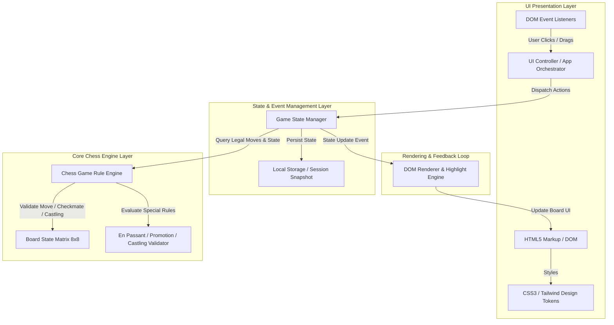
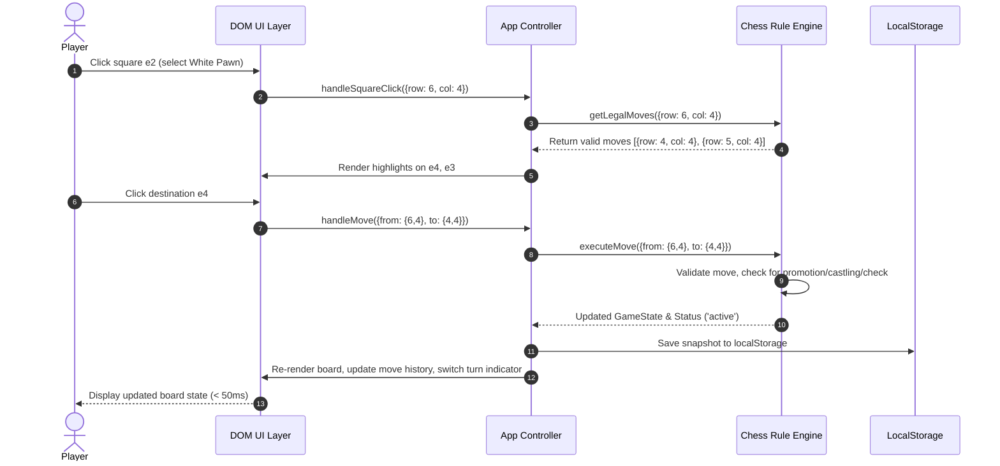

# 🏛️ Milestone 3: System Architecture & Component Design (Shanks)

As the **System Architect** of the Straw Hat Dev Crew, I have designed a robust, modular, and high-performance system architecture for our **Two-Player Local Chess Game**. 

This document defines the separation of concerns, component boundaries, state management lifecycle, data models, communication contracts, and scalability guarantees.

---

## 1. High-Level System Topology & Separation of Concerns

The architecture strictly adheres to modular layering, cleanly separating the pure chess rule engine from UI rendering and local storage persistence.



---

## 2. Component Boundaries & Decoupling

Following our design principles (avoiding boolean prop proliferation, utilizing compound component mentalities, and decoupling state from presentation):

| Layer / Module | Responsibility | Key Files / Subcomponents |
| :--- | :--- | :--- |
| **1. Visual Presentation** | Structural skeleton, layout containers, responsive grid. | `index.html`, `styles.css` |
| **2. Design Tokens** | Color schemes, piece icon mappings, board square variables, animations. | `styles.css` (CSS Custom Properties) |
| **3. State Orchestration** | Event handling, move history tracking, timer management, local persistence. | `app.js` (Orchestration Controller) |
| **4. Core Chess Engine** | Pure functional rules for piece movement, check/checkmate detection, FEN/PGN utilities. | `chess-engine.js` (or integrated robust logic module) |
| **5. Integration & Resilience** | Error boundaries, input throttling during animations, undo state stack. | `app.js` & `storage.js` |

---

## 3. Data Models & State Structure

### A. Game State Object (`GameState`)
```typescript
interface GameState {
  board: (Piece | null)[][]; // 8x8 matrix (Rank 8 index 0 to Rank 1 index 7)
  turn: 'w' | 'b';
  castlingRights: {
    w: { kingSide: boolean; queenSide: boolean };
    b: { kingSide: boolean; queenSide: boolean };
  };
  enPassantTarget: { row: number; col: number } | null; // Square vulnerable to en passant
  halfmoveClock: number; // For 50-move rule
  fullmoveNumber: number;
  moveHistory: MoveRecord[];
  capturedPieces: { w: PieceType[]; b: PieceType[] };
  gameStatus: 'active' | 'check' | 'checkmate' | 'stalemate' | 'draw';
  winner: 'w' | 'b' | null;
}

interface Piece {
  type: 'p' | 'n' | 'b' | 'r' | 'q' | 'k';
  color: 'w' | 'b';
  hasMoved?: boolean;
}

interface MoveRecord {
  from: { row: number; col: number };
  to: { row: number; col: number };
  piece: Piece;
  captured?: Piece;
  promotion?: 'q' | 'r' | 'b' | 'n';
  san: string; // Standard Algebraic Notation
}
```

---

## 4. Communication Contracts & Event Flows

### Move Execution Sequence Diagram


---

## 5. Scalability, Performance & Technical Risk Analysis

1. **Performance Guarantee (< 50ms Input Latency):**
   * *Mitigation:* Pure calculation of legal moves is done in-memory without blocking DOM paints. Board re-rendering uses targeted DOM node updates or efficient virtual DOM diffing equivalents (or direct class toggling on $8 \times 8$ grid cells).
2. **State Corruption & Crash Recovery:**
   * *Mitigation:* Every successful half-move serializes the `GameState` into `localStorage`. If a user accidentally refreshes the browser, the app hydrates from the last saved state snapshot.
3. **Complex Rule Edge Cases (Check, Pin, En Passant):**
   * *Mitigation:* The move generator filters out any candidate move that leaves the moving player's King in check, ensuring 100% adherence to official chess federation rules.

---

*Shanks' Sign-Off:* 
Architecture is fully locked down and optimized for sub-50ms performance and clean modular separation. Passing baton to **Nami** for the **Milestone 4: Sprint Planning & Task Breakdown**!