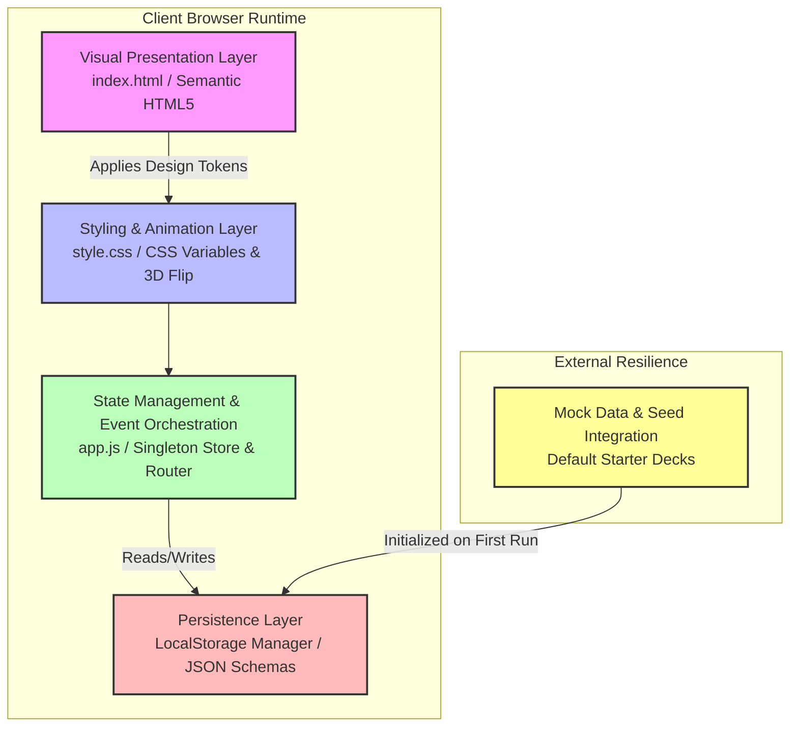
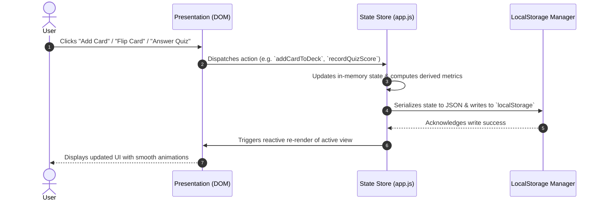

# Flashcard Study Hub: System Architecture & Specification Design
**Author:** Shanks (System Architect)  
**Standard:** Open Agent Skills Specification (`system-architecture-design` & `vercel-composition-patterns`)

---

## 1. System Overview & Architectural Vision

The **Flashcard Study Hub** is a client-side single-page application (SPA) engineered for lightning-fast active recall, deck organization, and self-assessment. To ensure a robust zero-latency user experience without requiring backend database infrastructure, the architecture leverages modern browser capabilities (`LocalStorage`, Web Animations API, CSS 3D transforms) while maintaining strict separation of concerns, modular component boundaries, and resilient state orchestration.

---

## 2. Component Boundaries & Layering Architecture

Following the **System Architecture & Component Decoupling** guidelines, the system is partitioned into five distinct layers:



### Layer Breakdown:
1. **Visual Presentation Layer (`index.html`):**
   - Semantic DOM skeleton containing container viewports (`#view-dashboard`, `#view-study`, `#view-quiz`), modal dialogs, navigation headers, and control toolbars.
2. **Design Token & Styling Layer (`style.css`):**
   - CSS custom properties (`--color-primary`, `--radius-lg`, `--shadow-card`, etc.), responsive flexbox/grid layouts, and GPU-accelerated 3D card flip transitions (`perspective`, `transform-style: preserve-3d`).
3. **State Management & Event Orchestration (`app.js`):**
   - Pure state container holding active decks, active study session pointers, quiz state, and UI navigation routing. Implements event delegation and reactive DOM updates.
4. **Integration Mock & Persistence Layer (`LocalStorage`):**
   - Encapsulated data access object (`StorageManager`) providing typed CRUD operations for decks and cards, fallback to robust starter decks on fresh installs, and schema versioning.

---

## 3. Data Flow & State Lifecycle

The state flow from user action to persistent storage and UI reflection is defined below:



---

## 4. Component Composition & Vercel Pattern Guidelines

In alignment with **Vercel Composition Patterns**, complex UI modules (such as Study Cards, Deck Cards, and Quiz Dialogs) avoid boolean prop proliferation (`isSmall`, `hasHeader`, `showFooter`, `isFlipped`) in favor of **Compound Component Architecture** and **Explicit Slot Patterns**:

- **Card Compound Pattern Example:**
  ```html
  <div class="flashcard-container [is-flipped]">
    <div class="card-face card-front">
      <!-- Front slot content -->
    </div>
    <div class="card-face card-back">
      <!-- Back slot content -->
    </div>
  </div>
  ```
- **State Decoupling:** Interactive study mechanics (timer, score tally, card shuffling) are managed within dedicated controller closures (`StudySessionController`), keeping visual elements purely presentational and stateless.

---

## 5. Data Model & Storage Schema (`LocalStorage`)

```json
{
  "version": "1.0.0",
  "decks": [
    {
      "id": "deck_1710000000000",
      "title": "AWS Cloud Practitioner Core",
      "description": "Essential AWS services, pricing models, and security pillars.",
      "createdAt": 1710000000000,
      "updatedAt": 1710000000000,
      "cards": [
        {
          "id": "card_1710000000100",
          "front": "What is the Shared Responsibility Model?",
          "back": "AWS is responsible for security *of* the cloud; the customer is responsible for security *in* the cloud.",
          "difficulty": "medium"
        }
      ]
    }
  ],
  "stats": {
    "totalStudied": 14,
    "streakDays": 3
  }
}
```

---

## 6. Technical Risks & Scalability Mitigations

| Risk Vector | Impact | Mitigation Strategy |
| :--- | :--- | :--- |
| **LocalStorage Quota Exceeded** | High data loss risk if user adds high-res media or extensive decks. | Implement data size checks before writes; stringify payloads efficiently; alert users if storage approaches 5MB limit. |
| **DOM Layout Thrashing during 3D Flip** | Janky animations on mobile or low-end devices. | Use `transform: rotateY()` and `backface-visibility: hidden` with GPU layer promotion (`will-change: transform`). |
| **State Desynchronization on Multiple Tabs** | Stale UI if user modifies decks in another tab. | Listen to `window.addEventListener('storage')` events to sync state across browser tabs in real-time. |
| **Loss of Unsaved Form Data** | Frustration if user navigates away while creating a deck. | Implement auto-draft caching in session state and confirmation dialogs on unsaved navigation. |

---

## 7. Acceptance Criteria & Verification Contract

1. **US-1.1 & 1.2 (Deck & Card CRUD):** Users can create decks, add/edit/delete front/back cards with instant reflection in UI and persistence in `LocalStorage`.
2. **US-2.1 (Interactive Flip Study):** 3D card flip works via mouse click and keyboard shortcuts (`Space` to flip, `ArrowRight`/`ArrowLeft` for navigation).
3. **US-2.2 (Mock Quiz & Evaluation):** Generates interactive multiple-choice or self-assessed quiz sessions with a final score summary dashboard.