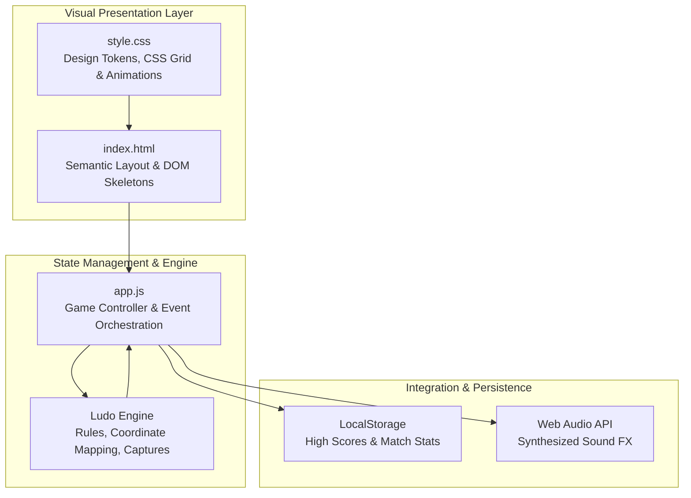
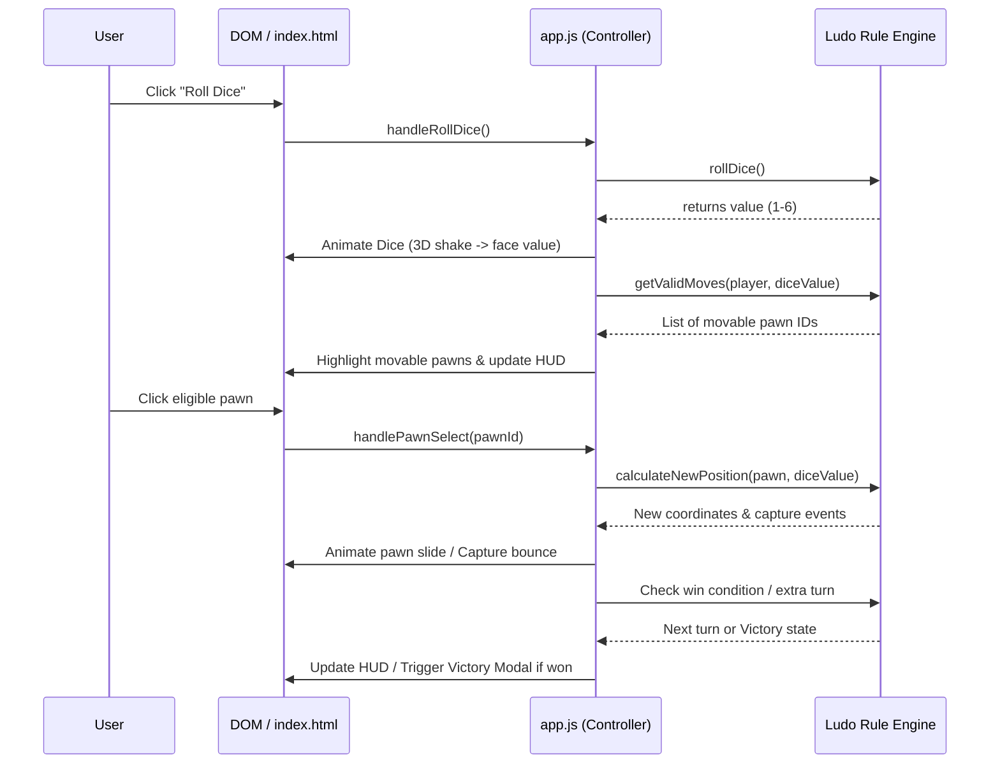

# System Architecture & Topology Design: Ludo Game

**Author**: Shanks (Group 2 - System Architect & Builder)  
**Project**: Ludo Game (Straw Hat Dev Crew)  
**Standard**: Open Agent Skills Specification (agentskills.io) - System Architecture Design v1.0.0 & Vercel Composition Patterns v1.0.0  

---

## 1. System Architecture Overview & Component Boundaries

The Ludo Game architecture strictly adheres to separation of concerns across presentation, state orchestration, game logic engines, and persistence layers.



### Component Decoupling & Responsibilities:
1. **Visual Presentation Layer (`index.html`)**:
   - Contains semantic containers for Start Screen, Player Selection Modal, Game Board (15x15 grid layout with 4 yards, main track, home columns, center triangle), Dice Container, Score/Turn HUD, and Victory Modal.
   - Designed with strict IDs and data attributes matching Robin's blueprint and Shanks' single-builder context to ensure zero element-mismatch bugs.

2. **Design Token & Styling Layer (`style.css`)**:
   - Custom CSS variables for color palettes (Red: `#ef4444`, Green: `#22c55e`, Yellow: `#eab308`, Blue: `#3b82f6`, Board background: `#f8fafc`, Dark accents: `#1e293b`).
   - Responsive CSS Grid and Flexbox layouts with aspect-ratio preservation for seamless mobile and desktop rendering.
   - Smooth CSS animations (`@keyframes rollDice`, `@keyframes pulseGlow`, `@keyframes bounceToken`, `@keyframes victoryConfetti`).

3. **State Management & Event Orchestration (`app.js`)**:
   - Centralized `GameState` object managing players, active turn index, dice roll status, pawn absolute and relative coordinate mappings, and game status (`IDLE`, `ROLLING`, `SELECTING_PAWN`, `MOVING`, `WON`).
   - Pure functional rule engine calculating valid moves, safe star intersections, home column entries, and opponent captures.

4. **Integration Mock Layer (`integrations.md`)**:
   - Documents LocalStorage schema for stats persistence and Web Audio API sound effect synthesizers (roll chime, capture pop, win fanfare).

---

## 2. Component Composition & Data Flow Architecture

Following **Vercel Composition Patterns**, UI containers and interactive modules are structured around compound component logic and decoupled state wrappers:



---

## 3. Communication Contracts & Data Structures

### A. LocalStorage Schema (`ludo_game_state`)
```json
{
  "settings": {
    "playerCount": 4,
    "players": [
      { "id": "red", "name": "Player 1", "color": "#ef4444", "type": "human" },
      { "id": "green", "name": "Player 2", "color": "#22c55e", "type": "human" },
      { "id": "yellow", "name": "Player 3", "color": "#eab308", "type": "ai" },
      { "id": "blue", "name": "Player 4", "color": "#3b82f6", "type": "human" }
    ]
  },
  "gameState": {
    "status": "PLAYING",
    "currentTurnIndex": 0,
    "diceValue": 6,
    "diceRolled": true,
    "consecutiveSixes": 0,
    "pawns": {
      "red_0": { "id": "red_0", "player": "red", "pos": -1, "state": "YARD" },
      "red_1": { "id": "red_1", "player": "red", "pos": -1, "state": "YARD" },
      "red_2": { "id": "red_2", "player": "red", "pos": 0, "state": "TRACK" },
      "red_3": { "id": "red_3", "player": "red", "pos": 56, "state": "HOME" }
    },
    "stats": {
      "gamesPlayed": 5,
      "wins": { "red": 2, "green": 1, "yellow": 1, "blue": 1 }
    }
  }
}
```

### B. Track Coordinate Mapping Specifications
- **Main Track**: 52 sequential squares indexed `0` to `51`.
  - **Red Start**: Index `0`
  - **Green Start**: Index `13`
  - **Yellow Start**: Index `26`
  - **Blue Start**: Index `39`
- **Safe Stars / Zones**: Indices `0`, `8`, `13`, `21`, `26`, `34`, `39`, `47`. Pawns on these squares cannot be captured.
- **Home Columns**: Each player has 6 private home stretch squares indexed `500` to `505` leading directly to the center home triangle (`600`).

---

## 4. Scalability & Resilience Contracts
1. **Concurrency Lock (`isAnimating`)**: Prevents state corruption during fast consecutive clicks on dice or pawns by locking user input until CSS animations resolve (`setTimeout` / `transitionend`).
2. **Auto-Skip Fallback**: If a player rolls a value where no legal moves exist, a non-blocking toast notification alerts the player and automatically passes the turn after 1.5 seconds.
3. **Responsive Scaling**: The Ludo board utilizes CSS `aspect-ratio: 1 / 1` and fluid viewport units (`min(90vw, 600px)`) ensuring flawless rendering across mobile portrait/landscape and desktop monitors.

---
*Shanks (Group 2 Builder) standing by. Proceeding immediately to authoring complete `index.html`, `style.css`, and `app.js` under the single-builder context protocol.*