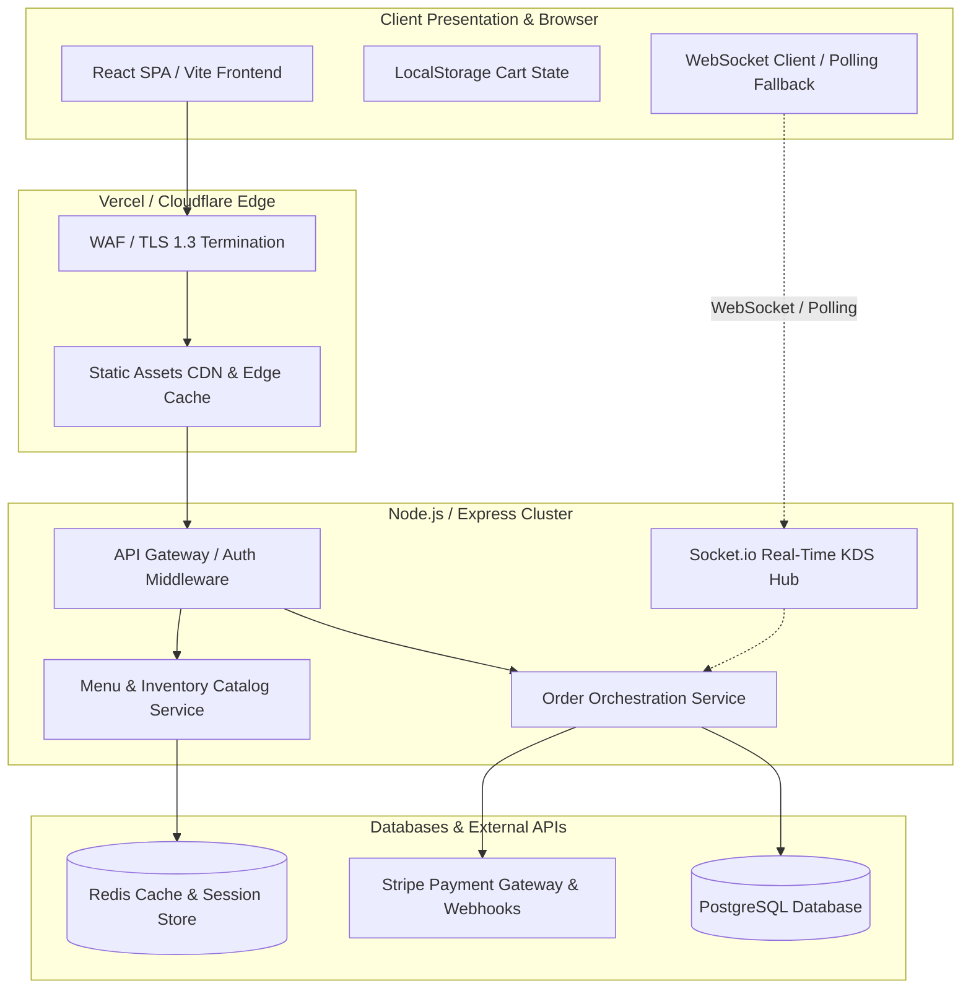

# 🏛️ SYSTEM ARCHITECTURE & TOPOLOGY DESIGN: Straw Hat Slice (Pizza Selling Platform)

**Prepared by:** Shanks (System Architect, Straw Hat Dev Crew)  
**Standard:** Open Agent Skills Specification (`system-architecture-design`, `vercel-composition-patterns`)

---

## 1. Executive Summary & Architectural Overview

**Straw Hat Slice** is engineered as a high-performance, real-time, resilient pizza selling platform. To satisfy high concurrency during peak dinner hours (500+ concurrent users, <250ms API response time, 99.9% uptime), the system adopts a decoupled **Modern Jamstack & Micro-Services-ready Architecture**.

The architecture strictly decouples:
1. **Visual Presentation Layer** (`index.html` / React SPA components)
2. **Design Token & Styling Layer** (Tailwind CSS / design token system)
3. **State Management & Event Orchestration** (React Context, Zustand / custom hooks)
4. **Integration Mock Layer & Network Resilience** (Stripe SDK, Socket.io / WebSocket client with auto-polling fallback)
5. **Container Runtime & Deployment Layer** (`Dockerfile`, Vercel / Node.js container topology)

---

## 2. High-Level System Architecture (Mermaid Diagram)



---

## 3. Component Boundaries & Separation of Concerns

### A. Visual Presentation Layer
* **Technologies**: HTML5, React 18+, Tailwind CSS.
* **Responsibilities**: Pure rendering of UI components. Strict adherence to Vercel Component Composition Patterns (no boolean prop proliferation; compound components like `<Card>`, `<Card.Header>`, `<Card.Body>`, `<Card.Footer>`).
* **File Structure**:
  * `src/components/ui/` -> Atomic & compound presentational elements (Buttons, Badges, Modals, Cards).
  * `src/components/builder/` -> Pizza customizer visual views.
  * `src/components/checkout/` -> Checkout form & payment views.
  * `src/components/kds/` -> Kitchen Display Screen board.

### B. Design Token & Styling Layer
* **Technologies**: CSS Variables, Tailwind CSS Configuration.
* **Responsibilities**: Centralized color palette (Warm Pizza red `#E63946`, Crust gold `#F4A261`, Background `#F8F9FA`), typography scales, spacing tokens, and responsive breakpoints.

### C. State Management & Event Orchestration
* **Technologies**: React Context / Zustand stores.
* **Responsibilities**: Decoupling business logic from UI components.
  * `CartStore`: Manages cart items, custom pizza modifiers, subtotal, taxes, and coupon application.
  * `AuthStore`: Manages JWT tokens, user profile state, and role permissions (`Customer`, `Kitchen`, `Admin`, `Delivery`).
  * `OrderStore`: Manages active order tracking status and real-time WebSocket event listeners.

### D. Integration Mock & Network Resilience Layer
* **Technologies**: Axios / Fetch wrapper with circuit breaker pattern, Stripe.js SDK, Socket.io client.
* **Responsibilities**: Graceful network failure handling. If WebSockets drop, automatically fall back to 10-second polling. Debounced API calls for cart updates and inventory checks.

### E. Container Runtime & Deployment Layer
* **Technologies**: Docker, Node.js Alpine base image, Nginx / Express production server.
* **Responsibilities**: Multi-stage build producing lightweight, immutable production artifacts.

---

## 4. Database Schema & State Contracts

### PostgreSQL Core Tables

1. **`users`**
   * `id` (UUID, PK)
   * `email` (VARCHAR, Unique)
   * `password_hash` (VARCHAR)
   * `role` (ENUM: `customer`, `kitchen`, `admin`, `driver`)
   * `created_at` (TIMESTAMP)

2. **`menu_items`**
   * `id` (UUID, PK)
   * `name` (VARCHAR)
   * `category` (ENUM: `pizza`, `side`, `bev`, `combo`)
   * `base_price` (DECIMAL)
   * `image_url` (TEXT)
   * `is_available` (BOOLEAN)

3. **`orders`**
   * `id` (UUID, PK)
   * `user_id` (UUID, FK, nullable for guests)
   * `guest_email` (VARCHAR, nullable)
   * `status` (ENUM: `received`, `baking`, `out_for_delivery`, `delivered`, `cancelled`)
   * `total_amount` (DECIMAL)
   * `delivery_address` (JSONB)
   * `created_at` (TIMESTAMP)

4. **`order_items`**
   * `id` (UUID, PK)
   * `order_id` (UUID, FK)
   * `menu_item_id` (UUID, FK, nullable for custom pizzas)
   * `customization` (JSONB: crust, sauce, cheese, toppings)
   * `quantity` (INT)
   * `unit_price` (DECIMAL)

5. **`coupons`**
   * `code` (VARCHAR, PK)
   * `discount_type` (ENUM: `percentage`, `fixed`)
   * `discount_value` (DECIMAL)
   * `min_order_value` (DECIMAL)
   * `expires_at` (TIMESTAMP)

---

## 5. Scalability & Technical Risk Mitigations

| Technical Risk | Impact | Mitigation Strategy |
|---|---|---|
| **Dinner Rush Traffic Spike (500+ concurrent users)** | API latency or database connection exhaustion | Redis caching for menu catalog queries; connection pooling via Prisma / pg-pool; horizontal auto-scaling of Node.js API containers behind Nginx load balancer. |
| **WebSocket Disconnection / Packet Loss** | Customer loses live order tracking | Automatic exponential backoff WebSocket reconnection + silent fallback to HTTP polling every 10 seconds. |
| **Double Charge / Duplicate Order on Rapid Multi-Click** | Frustrated customers and payment reconciliation errors | Client-side button disabling & loading spinner on "Place Order"; server-side idempotency keys tied to Stripe payment intents. |
| **Inventory Out-of-Stock Mid-Order** | Failed kitchen fulfillment | Real-time inventory check in Redis before Stripe payment authorization; instant refund hook if ingredient depletion occurs. |

---

## 6. Vercel Component Composition Pattern (Reference Implementation)

To adhere strictly to Vercel Component Composition standards (no boolean prop proliferation, compound subcomponents), here is the architectural specification for our reusable **`<Card>`** component:

```tsx
// Example Compound Component Structure
export function Card({ children, className }: { children: React.ReactNode; className?: string }) {
  return <div className={`rounded-xl border border-neutral-200 bg-white shadow-sm ${className || ''}`}>{children}</div>;
}

Card.Header = function CardHeader({ children }: { children: React.ReactNode }) {
  return <div className="border-b border-neutral-100 px-6 py-4">{children}</div>;
};

Card.Body = function CardBody({ children }: { children: React.ReactNode }) {
  return <div className="px-6 py-4">{children}</div>;
};

Card.Footer = function CardFooter({ children }: { children: React.ReactNode }) {
  return <div className="border-t border-neutral-100 bg-neutral-50 px-6 py-3">{children}</div>;
};
```

---

## 7. Deliverables & Next Steps
1. **Frontend Implementation**: React SPA with Tailwind CSS and Vite.
2. **Backend API**: Node.js / Express REST API with Socket.io real-time events.
3. **Containerization**: Production-ready `Dockerfile` and docker-compose topology for local testing.
4. **Documentation**: Comprehensive API contracts and integration notes.