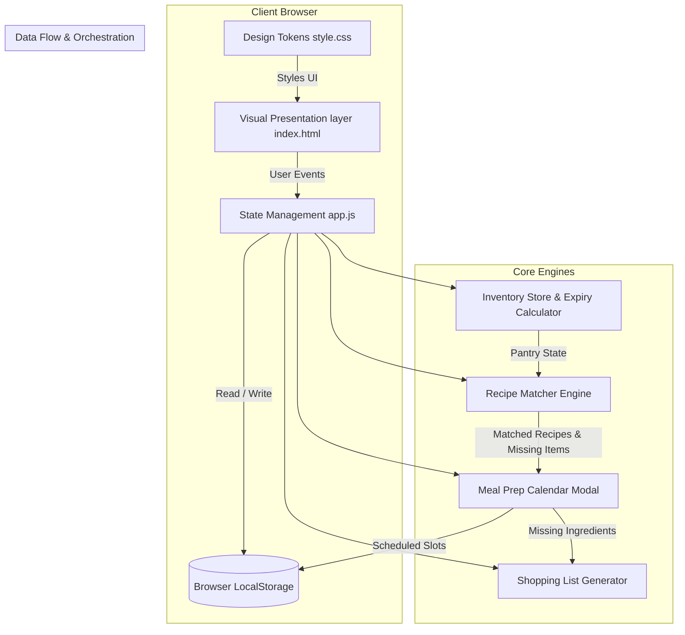

# 👑 System Architecture Design Document: Smart Pantry Chef (`smart-pantry-chef`)
**Lead System Architect:** Shanks  
**Referencing Specification:** Boa Hancock's Requirements & Specification Report for *Smart Pantry Chef*  
**Architecture Version:** 1.0.0  
**Compliance Standards:** Open Agent Skills Specification (`system-architecture-design`, `vercel-composition-patterns`)

---

## 1. Executive Summary & System Overview

**Smart Pantry Chef** is a modern, client-side progressive web application (PWA) / web dashboard designed to eliminate food waste, conquer decision fatigue, and streamline meal preparation. The system empowers users (such as Aria the Home Cook and Marcus the Meal Prepper) to track pantry inventory with expiration intelligence, discover recipes matching available ingredients filtered by dietary preferences, and organize weekly nutrition through an interactive meal prep calendar scheduling modal.

```
┌────────────────────────────────────────────────────────────────────────┐
│                        Smart Pantry Chef PWA                           │
│  ┌──────────────────────┐   ┌────────────────────────────────────────┐ │
│  │  Pantry Inventory    │   │         Recipe Engine & Matcher        │ │
│  │  - Expiry Tracking   │   │  - Ingredient Intersection Algorithm   │ │
│  │  - Category Filters  │   │  - Dietary Filter Subsystem            │ │
│  └──────────┬───────────┘   └───────────────────┬────────────────────┘ │
│             │                                   │                      │
│             └─────────────────┬─────────────────┘                      │
│                               ▼                                        │
│                 ┌───────────────────────────┐                          │
│                 │  Meal Prep Calendar Modal │                          │
│                 │  - 7-Day Grid Scheduler   │                          │
│                 │  - Missing Item Shopping  │                          │
│                 └───────────────────────────┘                          │
└────────────────────────────────────────────────────────────────────────┘
```

---

## 2. Component Boundaries & Decoupling Architecture

Following the **Open Agent Skills** guidelines for clean separation of concerns and Vercel Component Composition patterns (avoiding boolean prop proliferation and utilizing compound component architecture), the system is structured into five distinct layers:

### A. Visual Presentation Layer (`index.html`)
* **Responsibility:** Semantic HTML5 document structure, layout containers, accessibility landmarks (`aria-live`, `role="region"`), and responsive viewport framing.
* **Key Elements:** Header navigation, main dashboard grid, modal wrappers, toast notification containers.

### B. Design Token & Styling Layer (`style.css`)
* **Responsibility:** CSS Custom Properties (Design Tokens) for color palettes (pantry sage greens, amber warning badges, alert red for expired items), typography, spacing scales, and responsive flex/grid layouts.
* **Component Variants:** Modular CSS classes avoiding deep ternary nesting or boolean prop proliferation in markup.

### C. State Management & Event Orchestration (`app.js`)
* **Responsibility:** Pure business logic, immutable state updates, LocalStorage persistence synchronization, ingredient matching algorithms, and event publishing/subscription between UI components.
* **Sub-modules:**
  1. `InventoryStore`: CRUD operations for pantry items with expiration date calculations.
  2. `RecipeMatcher`: Algorithmic engine computing ingredient intersection percentage (Available vs. Required).
  3. `MealCalendarStore`: 7-day schedule manager with slot allocation.
  4. `ShoppingListGenerator`: Consolidated missing item calculation.

### D. Integration Mock Layer & Network Resilience (`integrations.md`)
* **Responsibility:** Mock API specifications for external recipe lookups, barcode scanning simulation, and cloud backup sync adapters.

### E. Container Runtime Layer (`Dockerfile`)
* **Responsibility:** Lightweight Nginx alpine containerization for static asset serving with optimal cache headers and gzip compression.

---

## 3. System Architecture & Data Flow Diagram



---

## 4. Technical Stack & Recommendations

| Layer | Recommended Technology | Rationale |
| :--- | :--- | :--- |
| **Language / Runtime** | Vanilla ES6+ JavaScript (Modular Modules) / TypeScript | Zero-build-step speed, immediate browser execution, robust typing support without heavy framework overhead. |
| **Styling** | Modern CSS3 with Custom Properties & Grid/Flexbox | Native performance, easy theme adjustments, robust responsive scaling. |
| **State Persistence** | `window.localStorage` with JSON serialization | Instant local persistence for offline pantry tracking without requiring an immediate backend database. |
| **Icons & Assets** | SVG Inline Sprites / Lucide-style SVG icons | Crisp rendering on high-DPI screens with zero external font blocking. |
| **Containerization** | Docker (Nginx Alpine) | Production-ready, ultra-lightweight web server image for deployment on AWS ECS/Fargate or Vercel. |

---

## 5. Scalability & Technical Risks

### A. Scalability Considerations
* **Client-Side Indexing:** Pantry inventories and recipe databases up to 1,000+ items perform instantaneously in browser memory. For enterprise expansion, implement pagination and virtualized list rendering (`IntersectionObserver`).
* **Recipe Matching Efficiency:** Pre-index recipe ingredient lookups using Hash Maps ($\mathcal{O}(1)$ lookup time) rather than nested array iteration ($\mathcal{O}(N \times M)$) to keep recipe filtering sub-50ms.

### B. Technical Risks & Mitigation Strategies
1. **Risk:** LocalStorage data corruption or quota limits exceeded (typically 5MB).
   * *Mitigation:* Implement robust try/catch blocks around JSON serialization, schema versioning headers, and automated export/import JSON backup utilities.
2. **Risk:** Expiry date timezone inconsistencies across client devices.
   * *Mitigation:* Store all dates in ISO 8601 UTC string format (`YYYY-MM-DD`), calculating remaining days delta in local midnight intervals.
3. **Risk:** Decision fatigue when users have 50+ unmatched pantry items.
   * *Mitigation:* Provide quick-filter toggle chips ("Use Expiring Soon First", "Under 30 Mins Prep", "Exact Match Only").

---

## 6. Communication Contracts & Storage Schema

### LocalStorage Schema (`smart_pantry_chef_state_v1`)
```json
{
  "inventory": [
    {
      "id": "item_1710000000001",
      "name": "Organic Whole Milk",
      "category": "Dairy",
      "quantity": 1,
      "unit": "carton",
      "expiryDate": "2025-03-12",
      "addedDate": "2025-03-05"
    }
  ],
  "recipes": [
    {
      "id": "rec_001",
      "title": "Creamy Garlic Pasta",
      "prepTimeMinutes": 20,
      "dietaryTags": ["Vegetarian", "Nut-Free"],
      "ingredients": [
        {"name": "Pasta", "amount": "200g"},
        {"name": "Garlic", "amount": "3 cloves"},
        {"name": "Whole Milk", "amount": "1 cup"}
      ],
      "instructions": "Boil pasta. Sauté garlic. Combine with milk and simmer."
    }
  ],
  "mealPlan": {
    "2025-03-10": {
      "lunch": null,
      "dinner": "rec_001"
    }
  },
  "dietaryPreferences": ["Vegetarian"]
}
```

---

## 7. Next Architectural Steps
1. Initialize project directory structure (`index.html`, `style.css`, `app.js`, `integrations.md`, `Dockerfile`).
2. Implement robust state management store in `app.js` following the schema above.
3. Construct compound UI components for pantry inventory cards, recipe match grids, and the 7-day meal prep calendar modal.