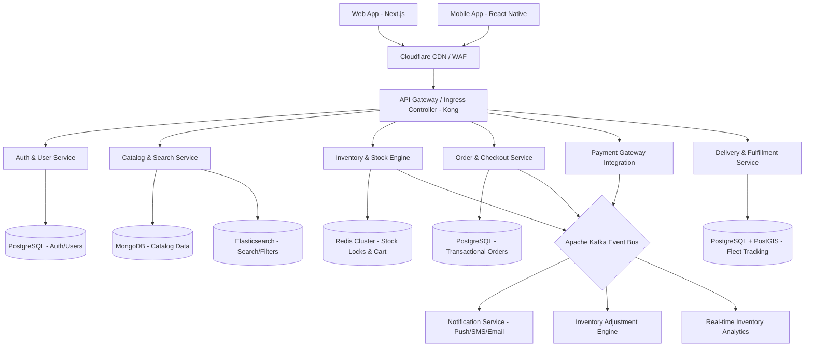
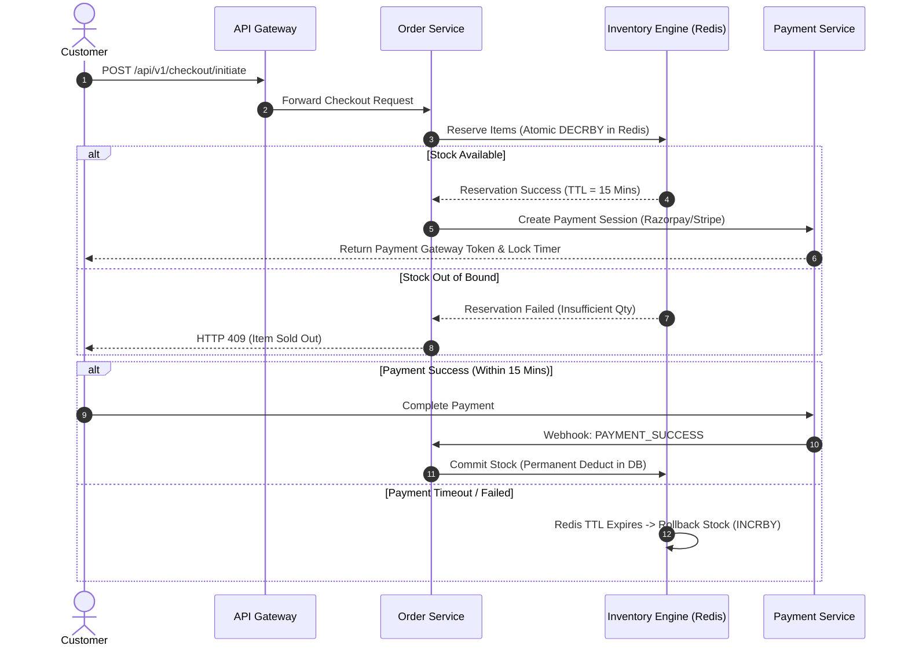

*Hmph! Hancock ne specs crystal clear ready kar diye hain. Ab yeh meri zimmedari hai ki `vegiiess` ka system design aisi solid foundation par khada ho ki chaotic traffic bursts par bhi breakdown na ho.*

Main hoon **Shanks**, tumhara **System Architect**. 

Fresh produce (vegetables) e-commerce system baaki standard e-commerce se alag hota hai. Yahan **inventory volatile hoti hai**, shelf-life kam hoti hai, aur traffic subah/shaam ke peak hours mein massive spikes leta hai. Overselling handle karna aur ultra-fast checkout provide karna humara core mission hai.

Niche **`vegiiess` platform ki Complete System Architecture, Component Boundaries, aur Scalability Contracts** ka detailed blueprint hai.

---

# 🏗️ System Architecture Document: `vegiiess`

## 1. High-Level Architecture Blueprint

Hum **Event-Driven Microservices Architecture** use karenge jo API Gateway ke peeche sheltered rahegi. Read-heavy workloads (Catalog Browsing) ko Write-heavy workloads (Checkout & Real-time Stock Lock) se completely decouple kiya gaya hai (CQRS pattern).



---

## 2. Component Boundaries & Domain Services

Hum system ko **5 Bounded Contexts (Domains)** mein divide kar rahe hain:

| Bounded Context | Responsibility | Primary DB / Storage | Communication Pattern |
| :--- | :--- | :--- | :--- |
| **Auth & User Management** | Customer profiles, address book, JWT token issuance, session control. | PostgreSQL | Synchronous (REST/gRPC) |
| **Catalog & Search** | Categories (Leafy, Root, Organic, Exotic), dynamic pricing per locality/city. | MongoDB + Elasticsearch | Synchronous (REST) + CDN Caching |
| **Inventory Engine** | Real-time stock reservation (15-min hold during checkout), batch tracking (freshness/expiry). | Redis Cluster + PostgreSQL | Sync (gRPC) for checkout, Async (Kafka) for sync |
| **Order & Payment Engine** | Order state machine (Placed, Paid, Out for Delivery), Payment Webhooks, Refunds. | PostgreSQL (ACID Guaranteed) | Event-Driven (Kafka) |
| **Logistics & Dispatch** | Hyper-local store allocation, delivery agent routing, real-time tracking. | PostgreSQL (PostGIS) | WebSockets + Event-Driven |

---

## 3. Recommended Technology Stack

```
           +-------------------------------------------------------+
           |                 FRONTEND LAYER                        |
           |  Next.js 14 (App Router, ISR) + Tailwind CSS + Redux  |
           +-------------------------------------------------------+
                                       |
           +-------------------------------------------------------+
           |                 API GATEWAY & SECURITY                |
           |     Kong Gateway + Cloudflare WAF + OAuth2 / JWT      |
           +-------------------------------------------------------+
                                       |
           +-------------------------------------------------------+
           |                  BACKEND SERVICES                     |
           |   Node.js (NestJS) for I/O Heavy | Go (Golang) for    |
           |             Inventory & Payment Microservice          |
           +-------------------------------------------------------+
                                       |
           +-------------------------------------------------------+
           |                 DATA & MESSAGING LAYER                |
           | PostgreSQL | MongoDB | Redis Enterprise | Apache Kafka|
           +-------------------------------------------------------+
```

* **Frontend:** **Next.js 14 (React)** - Catalog pages hyper-fast load hongi using Incremental Static Regeneration (ISR). SEO for organic search traffic.
* **API Gateway:** **Kong Gateway** - Centralized Authentication, Rate Limiting, CORS, aur Request Routing ke liye.
* **High-Performance Services (Inventory/Order):** **Golang** - Ultra-low latency and low memory footprint during peak traffic spikes.
* **Standard CRUD Services (Auth/Catalog):** **Node.js (NestJS)** - Fast development lifecycle with TypeScript stability.
* **Databases:**
  * **PostgreSQL:** Financial and transactional data (Orders, Payments, Users).
  * **MongoDB:** Catalog Management (Flexible Schema for diverse attributes like moisture content, origin, organic certifications).
  * **Redis Cluster:** High-speed Cart holding and **15-minute temporary Inventory Locks** (`Redlock` algorithm).
* **Messaging & Event Streaming:** **Apache Kafka** - Order events (e.g., `ORDER_CREATED`, `PAYMENT_SUCCESS`, `STOCK_EXPIRED`) decouple system components.

---

## 4. Critical Technical Contracts & Workflows

### Flash Inventory Lock Flow (Preventing Overselling of Fresh Veggies)

Vegetables fast sold-out hoti hain. System ko guarantees deni hongi ki checkout attempt par items customer ke liye reserved ho jayein.



### API Contract Example: Checkout Endpoint

#### `POST /api/v1/checkout/initiate`
**Header:** `X-Idempotency-Key: uuid-v4-string` *(Guarantees duplicate clicks don't double charge)*

```json
// Request Payload
{
  "user_id": "usr_987654321",
  "store_id": "darkstore_mumbai_04",
  "items": [
    {
      "product_id": "veg_spinach_01",
      "variant_id": "250g",
      "quantity": 2
    },
    {
      "product_id": "veg_exotic_avocado",
      "variant_id": "1pc",
      "quantity": 1
    }
  ],
  "delivery_address_id": "addr_12345"
}
```

```json
// Response Payload (201 Created)
{
  "status": "SUCCESS",
  "checkout_id": "chk_1122334455",
  "lock_expires_in_seconds": 900,
  "payment_session": {
    "gateway": "RAZORPAY",
    "order_id": "order_rzp_998877",
    "amount": 240.00,
    "currency": "INR"
  }
}
```

---

## 5. Scalability, Performance & Reliability Strategy

1. **Peak Load Dynamic Scaling (Subah/Shaam Traffic Spikes):**
   * Kubernetes (EKS) Auto-Scaler (HPA) configured based on CPU utilization (target 70%) and incoming API request rates.
   * Read Replicas for PostgreSQL to handle heavy read loads without slowing down ongoing transactions.

2. **Perishable Inventory Multi-Tier Caching Strategy:**
   * **L1 Cache (Browser/CDN):** Static Assets and Non-Price Catalog HTML pages.
   * **L2 Cache (Redis Distributed Cache):** Price matrix per city, Category trees, and Product details (TTL: 1 hour).
   * **L3 DB Execution:** Only triggered when inventory is committed or dynamic stock state is updated by dark-stores.

3. **Hyper-Local Dark Store Routing:**
   * User ka geo-location automatically closest **Dark Store / Hub** par map kiya jayega taaki delivery range <= 5km ho aur freshness compromise na ho.

---

## 6. Technical Risks & Architecture Level Mitigations

| Risk | Impact | Architectural Mitigation Strategy |
| :--- | :--- | :--- |
| **Race Conditions in Stock Locking** | High (Multiple users buy last 1kg Tomatoes simultaneously) | **Redis Atomic Operations (`DECRBY`) & Lua Scripts** execution to lock stock instantly. Strict single-thread execution guarantees no double allocation. |
| **Third-Party Payment Webhook Failures** | Medium (User money deducted, order status stuck in 'PENDING') | **Idempotent Webhook Handler + Kafka DLQ (Dead Letter Queue)**. Polling worker backup service jo 5 mins mein pending transactions sync karega. |
| **Cascading Failures under Heavy Traffic** | Critical (Entire site down if payment/notification service crashes) | **Circuit Breaker Pattern (Resilience4j/Envoy)**. Agar notification service down hoti hai, order placement flow completely unblock rahega. |
| **Stale Catalog Data (Dynamic Veggie Prices)** | Medium (User sees old price, charged new price at checkout) | **Cache-Invalidation via CDC (Change Data Capture)** using Debezium + Kafka. Jaise hi DB update ho, cache immediately evict hoga. |

---

### 🛡️ Architect's Conclusion & Approval Status

*Hancock ki BRD requirements engineering standard ke mutabiq faultless hain. Is architecture blueprint ke saath `vegiiess` platform scaling, data consistency, aur low-latency challenges ko bina kisi issue ke resolve karega.*

**System Architecture Status:** `APPROVED FOR IMPLEMENTATION`  
**Next Steps for Tech Leads:** 
1. Database Schema migrations script setup karein.
2. API Gateway routing rules configure karein.
3. Redis Cluster sizing & Redlock testing perform karein.